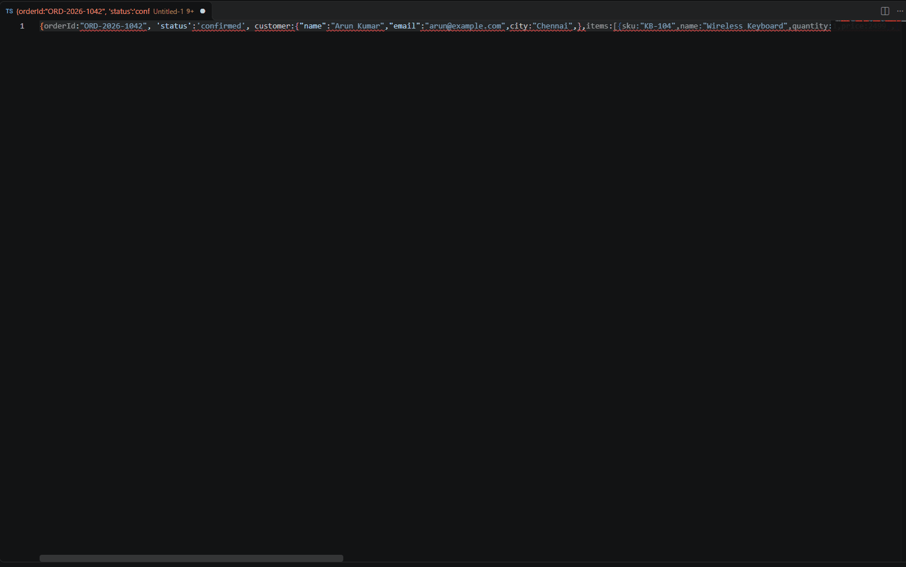
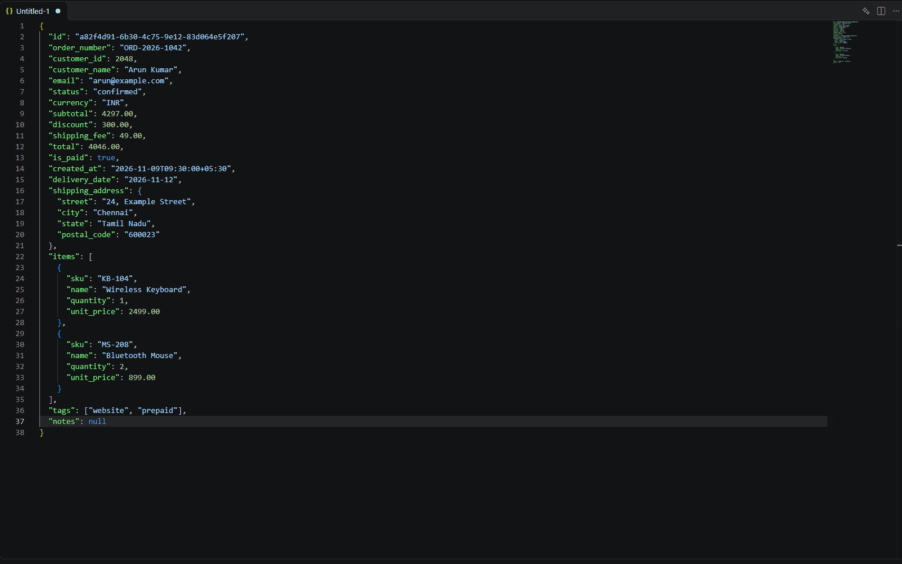

# JSON PowerHouse

Check, clean up and convert JSON without leaving VS Code. Turn a JSON sample into TypeScript, C#, Java, Python, Go and other types, into `CREATE TABLE` scripts for PostgreSQL, MySQL or SQLite, or into a Prisma schema or a JSON Schema.

Everything runs inside the editor. Your JSON is never uploaded anywhere.



## What it does

**Fix and clean up JSON**

- **Format JSON** repairs broken JSON before formatting it: single quotes, unquoted keys, trailing commas and comments, JSON copied out of a log line, and JSON that was cut off part-way. It only fixes syntax and never changes your keys or values. A short message tells you what was fixed.
- Problems are underlined as you type, each with a short explanation of what's wrong.
- Minify a file, strip comments, convert to JSON5, or flatten nested objects into `a.b.c` keys and back.
- Browse a large file as a tree, or compare two JSON files.

**Generate code from JSON**

TypeScript, C#, Java, Python, Go, Kotlin, Swift, Dart, Rust and PHP. Nested objects become their own types. Each language has its own options, such as namespace or package, serialization library (System.Text.Json, Newtonsoft, Pydantic, kotlinx, Jackson, Codable…) and access modifiers.



**Generate database tables and schemas**

- **PostgreSQL, MySQL and SQLite:** `CREATE TABLE` scripts with sensible column types. Nested objects and arrays become child tables linked by foreign keys, or JSON columns if you prefer. It can also write `INSERT` statements for your data.
- **Prisma:** models with relations, and `@map` so the database keeps snake_case names.
- **JSON Schema:** draft 2020-12 or draft-07, with required fields and formats such as `date-time`, `email` and `uuid` detected for you.

If your file is an array of records, all of them are taken into account, so a field that's missing from some records becomes optional.

## Getting started

Search for **JSON PowerHouse** in the Extensions view. It's on the [VS Code Marketplace](https://marketplace.visualstudio.com/items?itemName=arjayabalan.json-powerhouse-vscode) and on [Open VSX](https://open-vsx.org/extension/arjayabalan/json-powerhouse-vscode), so it also installs in Cursor, Windsurf and VSCodium.

1. Open a `.json` file, or select part of one.
2. Right-click and choose **JSON PowerHouse**, or click the ✨ button at the top right of the editor.
3. Pick a command. Generated code opens in a new tab next to your file.

Generators use the selection if there is one, and the whole file otherwise. Files with comments or trailing commas (JSONC, JSON5) are accepted as input.

## Examples

### Fixing broken JSON

Run **Format JSON** on this:

```
{'user_id': 1, name: "John",}
```

and you get:

```json
{
  "user_id": 1,
  "name": "John"
}
```

### Generating tables, models and types

Starting from this JSON:

```json
{ "id": 42, "name": "Ada", "email": "ada@example.com", "createdAt": "2026-01-15T09:30:00Z",
  "orders": [{ "sku": "A-100", "qty": 2 }] }
```

**JSON → PostgreSQL Tables** (root table name set to `users`):

```sql
CREATE TABLE IF NOT EXISTS users (
    id INTEGER NOT NULL PRIMARY KEY,
    name TEXT NOT NULL,
    email TEXT NOT NULL,
    created_at TIMESTAMPTZ NOT NULL
);

CREATE TABLE IF NOT EXISTS orders (
    id BIGINT GENERATED BY DEFAULT AS IDENTITY PRIMARY KEY,
    user_id INTEGER NOT NULL,
    sku TEXT NOT NULL,
    qty INTEGER NOT NULL,
    FOREIGN KEY (user_id) REFERENCES users (id) ON DELETE CASCADE
);
CREATE INDEX IF NOT EXISTS idx_orders_user_id ON orders (user_id);
```

**JSON → Prisma Schema** (root model name set to `User`):

```prisma
model User {
  id        Int      @id
  name      String
  email     String
  createdAt DateTime @db.Timestamptz(3) @map("created_at")
  orders    Order[]

  @@map("user")
}

model Order {
  id     Int    @id @default(autoincrement())
  userId Int    @map("user_id")
  sku    String
  qty    Int
  user   User   @relation(fields: [userId], references: [id], onDelete: Cascade)

  @@map("orders")
}
```

**JSON → TypeScript Interfaces** (Output set to *Interfaces only*):

```ts
export interface Root {
    id:        number;
    name:      string;
    email:     string;
    createdAt: Date;
    orders:    Order[];
}

export interface Order {
    sku: string;
    qty: number;
}
```

By default the TypeScript output also includes `Convert` helpers that parse JSON and check it against these types at runtime. Switch **Output** to *Interfaces only* if you just want the types.

## Changing options

Click ⚙ next to a generator in **All Generators…**, or the ⚙ button above a generated tab. You'll get that generator's most useful options. Change one and the open output updates straight away, so you can try settings and compare results.

Every option is also in VS Code's Settings (`Ctrl+,`, then search for `json-powerhouse`), with a section for each generator. Because they are ordinary settings, you can put them in your project's `.vscode/settings.json` and everyone on the team gets the same output.

| Setting | What it controls |
|---|---|
| `json-powerhouse.formatting.*` | Indentation, key sorting, quote style, comments |
| `json-powerhouse.validateOnSave` / `validateOnChange` | Whether files are checked automatically (both on by default) |
| `json-powerhouse.typescript.*`, `.csharp.*`, `.java.*` and the other languages | Options for each code generator |
| `json-powerhouse.sql.*` | Table name, child tables or JSON columns, `INSERT` statements, `IF NOT EXISTS` |
| `json-powerhouse.prisma.*` | Model name, database provider, `@map` names |
| `json-powerhouse.jsonSchema.*` | Draft version, required fields, formats |
| `json-powerhouse.telemetry.enabled` | Anonymous usage statistics (see below) |

## Commands

All commands are in the right-click menu under **JSON PowerHouse**, and in the Command Palette (`Ctrl+Shift+P`) when you type "JSON PowerHouse".

| Command | |
|---|---|
| Format JSON, Minify JSON | Repair if needed, then reformat the file or selection |
| Validate JSON | Check the file and list the problems |
| Transform › Normalize, Convert to JSON5, Flatten, Unflatten | Strip comments, convert, or flatten nested keys |
| Open Tree Viewer | Browse the JSON as a tree |
| Compare with Another File (Diff) | Compare two JSON files |
| JSON → TypeScript, PostgreSQL, MySQL, Prisma | The most-used generators, directly in the menu |
| All Generators… | Every generator in one searchable list, with your recent ones at the top |
| Generator Options… | Change the options of a generator |

## Usage statistics

To see which features people use and where things go wrong, the extension sends a small amount of anonymous data to [PostHog](https://posthog.com):

- the name of each command you run, and whether it came from the menu, the generator list or the options
- when a generation fails, the kind of failure (for example "invalid JSON"), not the error message
- the name of an option you change through ⚙, not the value you set
- once a day: the extension version, your editor and its version, the extension store it uses (VS Code Marketplace or Open VSX), your operating system and display language

Data is linked to VS Code's anonymous machine ID. **Your JSON, file names, folder paths, setting values and error messages are never sent.**

If you have turned off telemetry in VS Code (`telemetry.telemetryLevel`), nothing is sent. To turn it off for this extension only, set `json-powerhouse.telemetry.enabled` to `false`.

## Also on the web

Every tool is also available at [json-powerhouse.codarivu.com](https://json-powerhouse.codarivu.com) for when you're not in your editor. It works the same way: everything runs in your browser.

## Requirements

VS Code 1.80 or later, or an editor based on it such as Cursor, Windsurf or VSCodium.

## Feedback

Something not working, or JSON that doesn't convert the way you expected? [Open an issue on GitHub](https://github.com/1-arjayabalan-0/json-powerhouse/issues) and include a small sample if you can.

## License

Copyright © 2024–2026 Arjayabalan. Released under the [MIT License](LICENSE).
