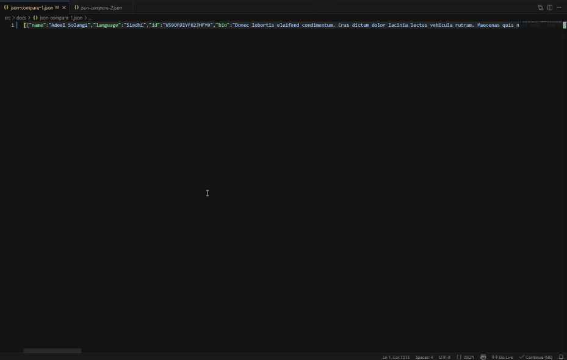
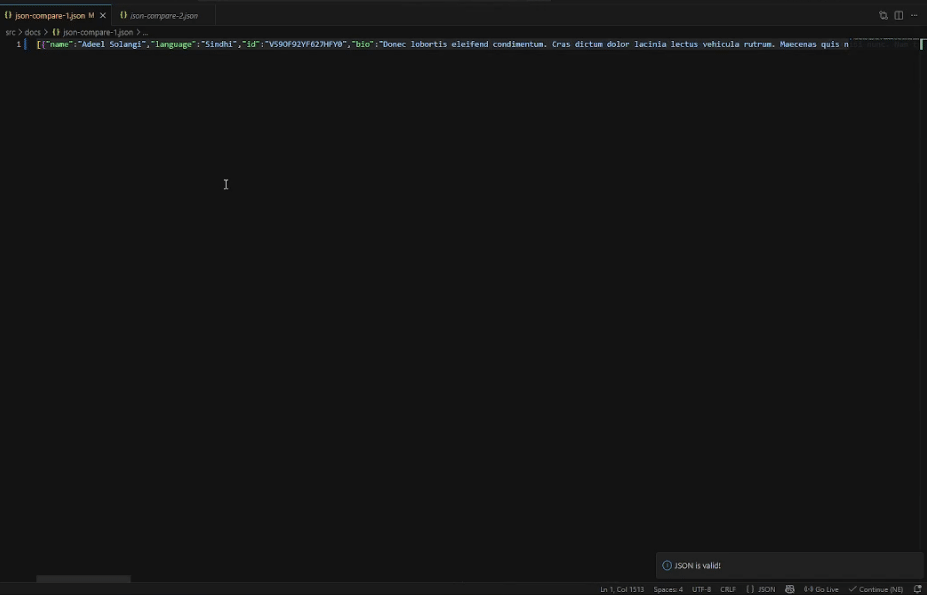
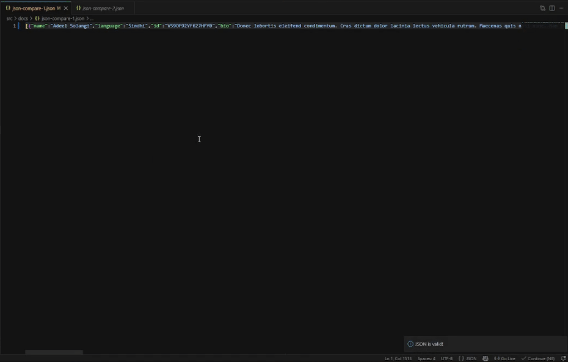

# JSON Powerhouse

> **Fix broken JSON and generate production-ready types — instantly, inside VS Code.**

[](https://marketplace.visualstudio.com/items?itemName=arjayabalan.json-powerhouse-vscode)
[](https://marketplace.visualstudio.com/items?itemName=arjayabalan.json-powerhouse-vscode)
[](https://opensource.org/licenses/MIT)
[](https://code.visualstudio.com/)

Paste messy, broken, or invalid JSON → get clean JSON and ready-to-use types in one command. No copy-pasting to online tools. No manual cleanup. No scripts. All processing runs locally inside your editor — your JSON never leaves your machine.

---

## 📸 Demo








---

## ✨ Features

- **Auto-fix broken JSON** — handles missing quotes, trailing commas, single quotes, unquoted keys, and more
- **Format & prettify** — clean, consistent output every time
- **Generate types instantly** — TypeScript, C#, Java, Python, Go, Kotlin, Swift, Dart, Rust and PHP
- **Generate database schemas** — PostgreSQL, MySQL and SQLite `CREATE TABLE` scripts (with optional `INSERT`s), Prisma models and JSON Schema
- **Options right where you generate** — click ⚙ to change a generator's options; open output updates instantly
- **Real-time validation** — catch errors as you type
- **Private by design** — all processing is local; your JSON never leaves your machine

---

## 🚀 Installation

1. Open VS Code
2. Go to the **Extensions** panel (`Ctrl+Shift+X` / `Cmd+Shift+X`)
3. Search for **JSON Powerhouse**
4. Click **Install**

Or install directly from the [VS Code Marketplace](https://marketplace.visualstudio.com/items?itemName=arjayabalan.json-powerhouse-vscode).

---

## ⚡ Quick Start

Paste this broken JSON into any `.json` file:

```json
{'user_id': 1, name: "John",}
```

Run `JSON PowerHouse: Format JSON` — you get:

```json
{
  "user_id": 1,
  "name": "John"
}
```

Then run `JSON PowerHouse: JSON → TypeScript Interfaces` — you get:

```ts
interface RootObject {
  userId: number;
  name: string;
}
```

Done. Two commands. Zero cleanup.

---

## ⌨️ Commands

Right-click in a JSON file and open **JSON PowerHouse**, click ✨ in the editor title bar, or open the Command Palette (`Ctrl+Shift+P` / `Cmd+Shift+P`) and type **JSON PowerHouse**:

| Command | Description |
|---|---|
| `Format JSON` / `Minify JSON` | Fix and prettify, or compact, the JSON |
| `Validate JSON` | Check JSON for errors, with one-click fixes |
| `Transform` › Normalize, JSON5, Flatten, Unflatten | Strip comments, convert to JSON5, flatten or unflatten keys |
| `Open Tree Viewer` / `Compare with Another File (Diff)` | Explore or compare JSON |
| `JSON → TypeScript / C# / Java / Python / Go / Kotlin / Swift / Dart / Rust / PHP` | Generate types and classes |
| `JSON → PostgreSQL / MySQL / SQLite Tables` | `CREATE TABLE` scripts, with child tables and foreign keys for nested data |
| `JSON → Prisma Schema` / `JSON → JSON Schema` | Prisma models with relations, or a JSON Schema |
| `All Generators…` | Searchable list of every generator, with ⚙ options on each row |
| `Generator Options…` | Change a generator's options; open output updates instantly |

Generators work on the selection, or on the whole file when nothing is selected. JSONC and JSON5 input (comments, trailing commas) is accepted.

> Keyboard shortcuts can be customised in **File → Preferences → Keyboard Shortcuts**.

---

## ⚙️ Configuration

Open **Settings** (`Ctrl+,`) and search for `json-powerhouse`. Every generator has its own section (TypeScript, C#, SQL, Prisma, …), and its most useful options are also one click away via ⚙.

| Setting | Description | Default |
|---|---|---|
| `json-powerhouse.formatting.indentation` | `2`, `4`, `tab` or `0` | `2` |
| `json-powerhouse.formatting.keySorting` | `none`, `asc` or `desc` | `none` |
| `json-powerhouse.validateOnSave` / `validateOnChange` | Validate automatically | `true` |
| `json-powerhouse.typescript.*`, `.csharp.*`, `.java.*`, … | Code generator options | |
| `json-powerhouse.sql.*`, `.prisma.*`, `.jsonSchema.*` | Schema generator options | |
| `json-powerhouse.telemetry.enabled` | Anonymous usage statistics (see [Telemetry](#-telemetry)) | `true` |

---

## 🧠 Built for real-world JSON

Most JSON tools assume your data is valid. Real API responses rarely are.

JSON Powerhouse is designed for the messy, inconsistent payloads that show up in actual development — broken logs, partial responses, copy-pasted output from terminals, third-party APIs with inconsistent formatting. It fixes what it finds and generates types from what remains.

**Common scenarios where it helps:**

- Integrating a new backend and need types fast
- Debugging a broken API response in production
- Working with legacy data that nobody cleaned up
- Switching between languages and needing type stubs quickly

---

## 📊 Telemetry

To learn which features are used and what to improve, JSON PowerHouse sends **anonymous** usage statistics:

- which command was run (for example "Format JSON" or "JSON → Prisma Schema") and whether it was started from the menu, the generator list or the ⚙ options
- whether a generation failed, as a category only (for example "invalid JSON")
- which generator option was changed via ⚙ — the option's name, never its value
- a once-a-day "active" ping, plus the extension version, editor name and version, which extension store the editor uses (VS Marketplace or Open VSX — a private gallery is reported only as "other"), OS and display language

Events are identified by VS Code's anonymous machine ID. **Your JSON, file names, paths, setting values and error messages are never sent.** Data is sent to [PostHog](https://posthog.com).

Nothing is sent when VS Code telemetry is turned off (`telemetry.telemetryLevel`). To turn off only this extension's telemetry, set `json-powerhouse.telemetry.enabled` to `false`.

---

## 📋 Requirements

- Visual Studio Code **1.80 or later**

---

## 🤝 Contributing & Support

Found a bug or have a feature request?
Open an issue on [GitHub](https://github.com/1-arjayabalan-0/json-powerhouse).

Pull requests are welcome.

---

## 📝 License

[MIT](LICENSE) © 2024 Arjayabalan